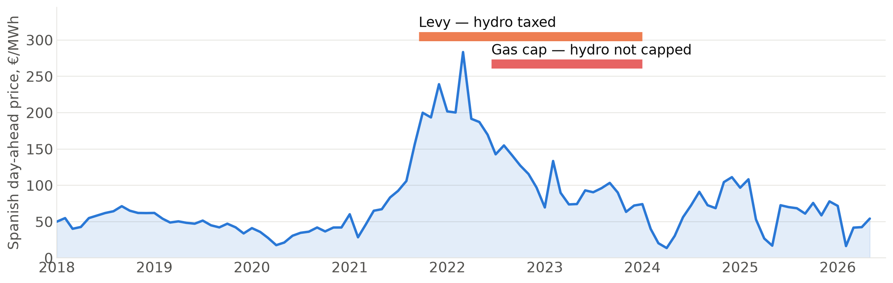
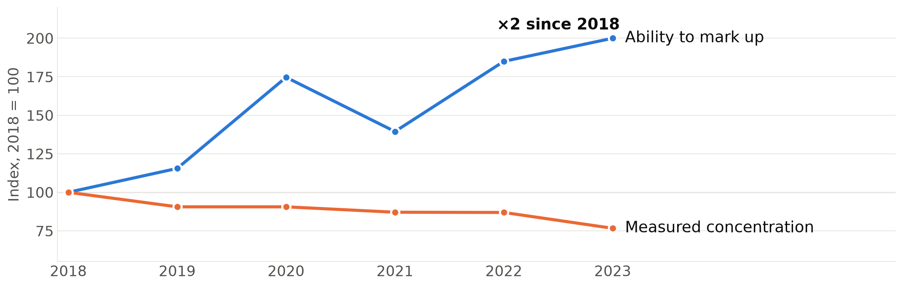
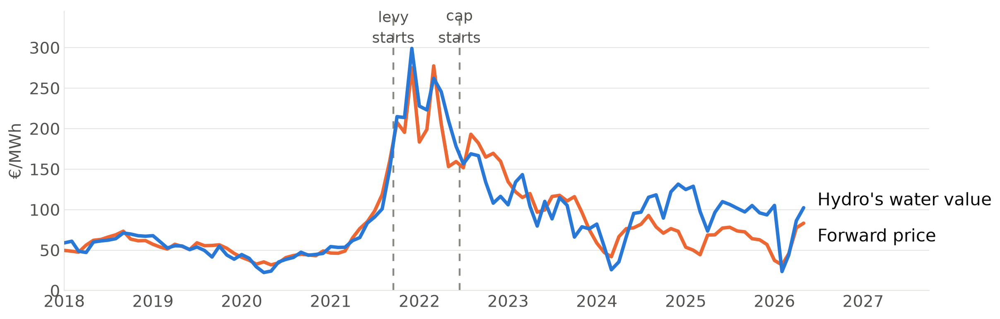
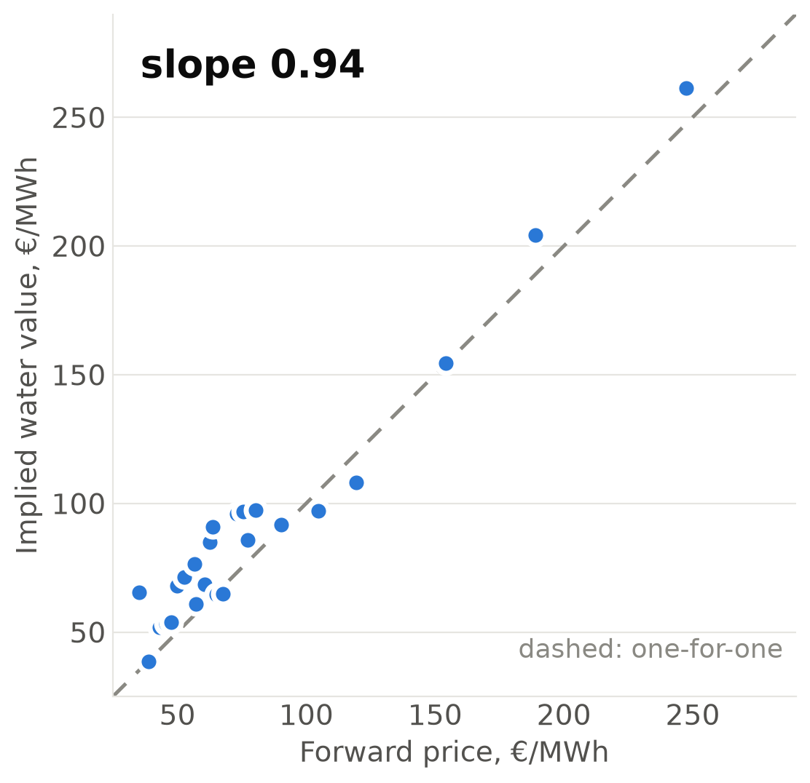
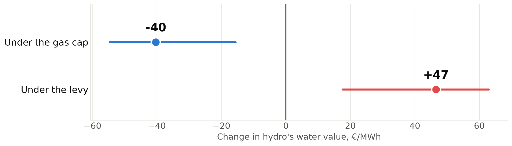

# Did hydro change how it bid when Spain intervened?

{width=100%}

Two emergency policies. Hydro is **taxed** by one and **left uncapped** by the
other — and it sets the price in 30–52 % of hours.

# Why it matters: market power doubled while concentration fell

{width=100%}

Renewables push the price into hours with fewer flexible plants. Same firms,
same shares — **fewer competitors where the price is set.**

# The problem: hydro's bids follow the gas price, not policy dates

{width=100%}

Hydro bids the value of **stored water**, which moves with expected future
prices. Nothing visible happens on either policy date.

# The model: recover the water value, then net the price out

:::::: columns
::: {.column width="52%"}
{width=100%}
:::
::: {.column width="45%"}
\vspace{1.2em}
$$c_{it} = p^*_t - \frac{q_{it}-Q^C_{it}}{\lvert RD'_{it}\rvert}$$
\vspace{0.6em}

What the plant's **own bid** implies its water is worth.

\vspace{0.4em}

It tracks the forward price almost one-for-one — **the confound, now
measurable, and removable.**
:::
::::::

# First result: what is left once the price channel is removed

{width=100%}

Both robust to a cluster bootstrap. **But not yet reportable** — these windows
are also the gas crisis and the cap's own price suppression.

**Next:** run the same test on a *non-hydro* plant. Both move → artifact. Only
hydro moves → conduct.
